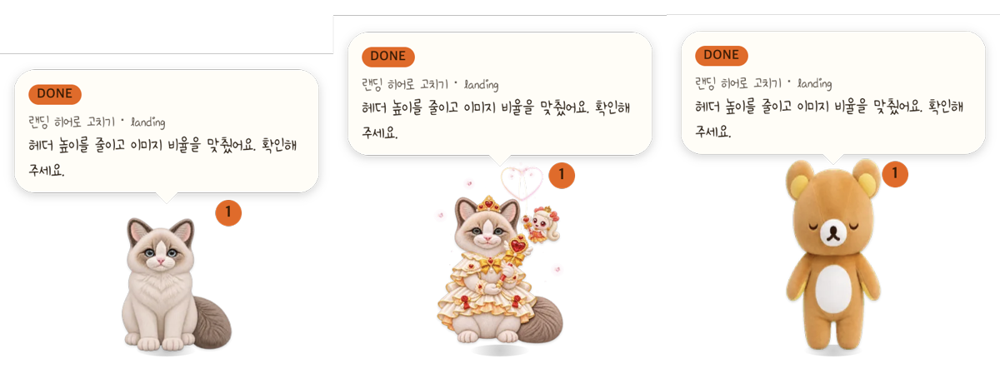

<h1 align="center">레토 (Retto)</h1>

<p align="center">
  <strong>Claude Code · Codex 가 일하는 동안 화면 구석에서 상태를 알려 주는 고양이. 누르면 그 세션으로 데려간다.</strong>
</p>

<p align="center">
  <a href="https://github.com/rehyundesign/retto/releases/latest"></a>
  <a href="https://github.com/rehyundesign/retto/releases"></a>
  <a href="LICENSE"></a>
  <a href="https://github.com/rehyundesign/retto/actions/workflows/windows.yml"></a>
</p>

<p align="center">
  <a href="#여기서-시작">다운로드</a> ·
  <a href="#색으로-보는-상태">색으로 보는 상태</a> ·
  <a href="#스킨-14종">스킨 14종</a> ·
  <a href="#설치">설치</a> ·
  <a href="#slack-알림">Slack</a> ·
  <a href="#막힐-때">막힐 때</a> ·
  <a href="#결정-기록">결정 기록</a> ·
  <a href="#in-english">English</a>
</p>

<p align="center">
  
</p>

<p align="center">
  <sub><em>작업 중 · 입력 대기 · 완료 · 실패. 이름표 색만 봐도 지금 무슨 일인지 안다. (맥 앱이 실제로 그린 화면)</em></sub>
</p>

---

## 이게 뭔가

Claude Code 와 Codex 에 일을 맡겨 두고 다른 창에서 일하다 보면, 끝났는지 · 내 답을 기다리는지 · 실패했는지를 확인하러 창을 계속 오가게 된다.
레토는 화면 구석(모든 데스크톱 · 전체화면 위)에 앉아 그 상태를 **이름표 색과 동작**으로 알려 준다. 말풍선에는 AI 가 방금 한 말이 보이고, **누르면 그 세션이 있는 창 · 탭으로 데려간다.**

VS Code · Claude 앱 · 터미널 · Codex · Orca 에서 띄운 세션을 앱 하나가 함께 본다. Slack DM · 멘션도 같은 자리에 알린다.

## 여기서 시작

| 쓰는 컴퓨터 | 받기 | 비고 |
| --- | --- | --- |
| **맥** (Apple Silicon · macOS 13 이상) | `brew install --cask retto` (추천) 또는 [DMG 받기](https://github.com/rehyundesign/retto/releases/latest) | [설치](#맥) |
| **Windows** 10 · 11 (베타) | [x64 zip](https://github.com/rehyundesign/retto/releases/download/v0.12.1-beta.4-windows/Retto-0.12.1-beta.4-windows-x64.zip) · [ARM64 zip](https://github.com/rehyundesign/retto/releases/download/v0.12.1-beta.4-windows/Retto-0.12.1-beta.4-windows-arm64.zip) | [설치](#windows-베타) · [맥과 같은 것 · 다른 것](docs/windows.md) |

> **저장소의 「Releases → Latest」는 맥 DMG 다.** Windows 판은 베타라 「Pre-release」로 올린다. Windows 에서 받을 때는 위 표의 링크를 쓴다.

두 판 모두 **Node.js** 가 있어야 한다(상태를 전해 주는 훅이 node 로 돈다). 처음 켜면 「AI 연동 확인」 창이 무엇이 빠졌는지 알려 준다.

## 무엇이 다른가

- **창을 오가지 않아도 된다.** 이름표 색이 상태다. 초록이면 일하는 중, 파랑이면 내 답을 기다리는 중, 주황이면 끝났는데 아직 안 봤고, 빨강이면 실패다.
- **누르면 그 자리로 간다.** VS Code 면 새 창을 만들지 않고 그 대화 탭을, Codex 면 그 스레드를, Orca 면 그 채팅 탭을 연다.
- **여러 세션 중 급한 것부터 보여 준다.** 입력 대기 → 실패 → Slack 새 메시지 → 완료 → 작업 중 순서다. 다른 세션이 기다리면 배지 숫자로 알린다.
- **훅이 없어도 보인다.** Codex 는 작업 기록(롤아웃)을 직접 읽어, 훅을 승인하지 않았거나 Orca 처럼 훅이 꺼진 채팅도 찾는다.
- **아무것도 보내지 않는다.** 레토는 내 컴퓨터의 기록만 읽는다. 대화 내용을 바깥으로 보내지 않고, Slack 토큰은 이 컴퓨터에만 암호화해 둔다.

## 이렇게 쓴다

**긴 작업을 맡기고 문서를 쓸 때.** Claude Code 에 리팩터링을 맡기고 다른 창으로 간다. 레토가 초록으로 생각 중이다가, 명령 승인이 필요해지면 파랑으로 바뀌고 말풍선에 「이 명령을 실행해도 될까요?」가 뜬다. 레토를 누르면 그 VS Code 탭이 앞으로 온다.

**Codex 세 개를 동시에 돌릴 때.** 하나가 끝나면 주황 배지 1, 둘이 끝나면 2. 배지를 누르면 끝난 세션 목록이 뜨고, 고르면 그 스레드로 간다. 읽은 것은 배지에서 빠진다.

**Orca 에서 여러 채팅을 띄웠을 때.** Orca 의 Codex 채팅이 승인을 기다리면 파랑으로 알리고, 누르면 같은 워크스페이스에 채팅이 여럿이어도 그 탭으로 간다.

## 색으로 보는 상태

| 이름표 | 뜻 | 레토 |
| --- | --- | --- |
| 🟢 초록 · THINKING / USING A TOOL | AI 가 생각하거나 도구를 쓰는 중 | 턱을 괴고 생각한다 |
| 🔵 파랑 · NEEDS YOU | 권한 승인 · 질문 등 내 답을 기다린다 | 나를 쳐다본다 |
| 🟠 주황 · DONE | 끝났는데 아직 안 봤다. 배지 숫자가 이 개수다 | 손을 흔든다 |
| 🔴 빨강 · OOPS | 실패 | 시무룩하다 |
| 🟣 보라 · SLACK | Slack 새 메시지 | — |
| ⚪ 회색 · RESTING | 쉬는 중. 10분 넘게 조용하면 레토도 잔다 | 쉬거나 잔다 |

## 누르면 어디로 가나

| 세션이 열린 곳 | 누르면 |
| --- | --- |
| VS Code (Claude Code 확장) | 그 폴더 창을 앞으로 보내고 그 대화 탭을 되살린다 |
| Claude 앱 | 맥: 사이드바에서 그 대화를 고른다(손쉬운 사용 권한 필요) · Windows: Claude 앱을 앞으로 가져온다 |
| Codex 앱 · Codex CLI | `codex://` 로 그 스레드를 연다 |
| Orca (Claude · Codex 채팅, 터미널 탭) | Orca 의 그 탭으로 간다 |
| Slack | Slack 앱에서 그 메시지를 연다 |

몸통 · 말풍선 · 배지마다 하는 일과 메뉴는 [메뉴에서 무엇을 고를 수 있나](docs/사용법.md)에 있다.

## 되는 것과 준비가 필요한 것

| ✅ 설치하면 바로 된다 | 🧩 준비하면 된다 |
| --- | --- |
| Claude Code(VS Code · 터미널 · Claude 앱) 상태 | Node.js 설치 — 없으면 레토는 떠 있어도 움직이지 않는다 |
| Codex 상태 · 완료 · 질문 대기 | Codex 훅 승인 — 설치 직후 Codex 를 한 번 다시 켜서 허용한다 |
| Orca 에서 띄운 세션 · 그 탭으로 가기 | Slack 알림 — 내 Slack 앱의 토큰 두 개([연결 안내](docs/Slack-연결.md)) |
| 스킨 14종 · 위치 · 크기 · 글꼴 고르기 | |

| | 맥 | Windows 베타 |
| --- | --- | --- |
| 상태 · 배지 · 말풍선 · 스킨 14종 · Slack · Orca | ✅ | ✅ |
| Claude 앱의 그 대화로 바로 가기 | ✅ | 앱을 앞으로 가져오는 데까지 |
| Codex 앱 실시간 상태 · 창 제목으로 읽음 판단 | ✅ | — |
| 실제 PC 에서 확인 | ✅ | 실제 Windows(GitHub Actions)에서 설치 · 훅 · 화면 · Orca · 스킨을 커밋마다 점검. 로그인한 실사용은 아직 |

## 스킨 14종

<p align="center">
  
</p>

메뉴의 **스킨**에서 고른다. 스킨마다 효과 · 시선 · 끌 때 달리는 그림 · 자는 그림이 따로 있다. Windows 판도 맥 앱이 그린 같은 그림을 쓴다.

## 설치

### 맥

```sh
brew tap rehyundesign/retto
brew install --cask retto
```

1. 위 두 줄을 터미널에 붙여 넣는다. (Homebrew 가 없으면 [DMG](https://github.com/rehyundesign/retto/releases/latest)를 받아 `Retto.app` 을 「응용 프로그램」으로 끌어다 놓는다)
2. 레토를 켜면 「AI 연동 확인」 창이 뜬다. 훅 · node · 클라이언트가 모두 ✓ 인지 본다.
3. Claude Code 와 Codex 를 한 번 다시 켠다. Codex 는 훅 승인 화면이 뜨면 허용한다.
4. 아무 요청이나 하나 보내면 레토가 초록으로 바뀐다.

<details>
<summary><strong>받는 길마다 다른 점 · 직접 빌드</strong></summary>

레토는 애플 개발자 서명이 없다. 받는 길에 따라 첫 실행만 다르다.

| 길 | 첫 실행에서 막히나 |
| --- | --- |
| `brew install --cask retto` | 아니오 — cask 가 격리 표시를 뗀다 |
| `git clone` 뒤 `macos/scripts/build.sh --install` | 아니오 — 내려받은 파일이 아니라 격리 표시가 없다 |
| DMG 를 「응용 프로그램」으로 끌어다 놓기 | 예 — 시스템 설정 → 개인정보 보호 및 보안 → 「그래도 열기」 한 번 |

직접 빌드하려면 Xcode 명령줄 도구가 필요하다(`xcode-select --install`). 탭은 [rehyundesign/homebrew-retto](https://github.com/rehyundesign/homebrew-retto) 다.
14종 스킨을 이 컴퓨터 설치본과 파일까지 같게 받으려면 [로컬 동일본 ZIP](https://github.com/rehyundesign/retto/releases/download/v0.12.1-local.20261113/Retto-local-14skins-20261113.zip)([안내](docs/20261113-local-snapshot.md))을 쓴다.

</details>

### Windows (베타)

<p align="center">
  
</p>

<p align="center"><sub><em>Windows 판 화면(같은 앱을 맥에서 띄워 그렸다). Windows 판은 말풍선이 레토 위에 뜬다.</em></sub></p>

1. [x64 zip](https://github.com/rehyundesign/retto/releases/download/v0.12.1-beta.4-windows/Retto-0.12.1-beta.4-windows-x64.zip)을 받는다. ARM 노트북(Snapdragon 등)이면 [ARM64 zip](https://github.com/rehyundesign/retto/releases/download/v0.12.1-beta.4-windows/Retto-0.12.1-beta.4-windows-arm64.zip).
2. 압축을 풀고 `Retto.exe` 를 실행한다. 「Windows의 PC 보호」 창이 뜨면 **추가 정보 → 실행**(서명이 없어서다).
3. 처음 뜨는 「AI 연동 확인」 창에서 **훅 설치**를 누른다.
4. Claude Code 를 다시 켜고 요청을 하나 보낸다. 레토는 작업 표시줄 옆 트레이에도 있다 — 우클릭하면 메뉴(스킨 · Slack 설정 · 세션 목록)가 열린다.

[Node.js LTS](https://nodejs.org/) 가 PATH 에 있어야 훅이 돈다. 써 보고 이상하면 「AI 연동 확인」 창 화면을 [이슈](https://github.com/rehyundesign/retto/issues)로 보내 주면 된다.

<details>
<summary><strong>Windows 판은 어디까지 확인했나</strong></summary>

Windows PC 에서 사람이 직접 써 본 적은 아직 없다. 대신 커밋마다 GitHub Actions 의 실제 Windows 에서 다음을 돌린다 — 훅 설치 → cmd · PowerShell · Git Bash 로 훅 실행 → 화면 → 제거, 토큰 암호화(DPAPI) · 연결 유지 · 한글 경로, Orca Windows 판에 붙기, 스킨 14종 화면.
로그인이 필요한 실제 Claude Code · Codex 세션과 실제 Slack 계정은 아직 확인하지 못했다. 자세히는 [docs/windows.md](docs/windows.md).

</details>

## Slack 알림

메뉴의 **Slack 설정…**에서 DM · 내 멘션 · 고른 채널의 새 메시지를 알린다. 별도 서버 없이 Slack 공식 Socket Mode 로 받는다.
내 Slack 앱을 하나 만들어 사용자 토큰(`xoxp-`)과 앱 토큰(`xapp-`)을 넣는다 — 설정 창의 **처음 연결하시나요? 연결 안내 ↗** 와 [Slack 연결](docs/Slack-연결.md)에 순서가 있다.
같은 사람이 여러 개 보내면 `+3` 처럼 묶고, Slack 에서 읽은 메시지는 레토에서도 사라진다. 메시지 본문은 디스크에 쓰지 않는다.

## 막힐 때

| 증상 | 확인할 것 |
| --- | --- |
| 레토가 회색으로 잠만 잔다 | 메뉴 **AI 연동 확인** — 훅 · node 중 빠진 것을 알려 준다. 맥은 `scripts/doctor.command` 로 어디서 멈췄는지 본다 |
| Codex 만 안 보인다 | Codex 를 다시 켜서 훅 승인 화면을 허용했는지 본다. 승인 전에도 작업 · 완료는 작업 기록으로 보인다 |
| 누르면 엉뚱한 창이 열린다 | 맥은 메뉴에서 세션 열 곳을 고를 수 있다 — [클릭하면 어디로 가는가](docs/세션-열기.md) |
| 맥에서 첫 실행이 막힌다 | DMG 로 받았다면 시스템 설정 → 개인정보 보호 및 보안 → 「그래도 열기」. brew 로 받으면 이 단계가 없다 |
| Windows 에서 훅이 안 돈다 | `node -v` 가 터미널에서 되는지 본다. Node.js 를 설치한 뒤 Claude Code 를 다시 켠다 |

## 만든 사람

> **Retto** · luxia yoon 의 랙돌 고양이 · 영어 표기는 `t` 를 둘 쓴다 — Reto 가 아니라 **Retto**.
> 만든 사람 luxia yoon · ydh3600@gmail.com · [linkedin.com/in/donghyunyoon](https://www.linkedin.com/in/donghyunyoon/)
> 앱에서는 메뉴 → **Retto 정보** 에서 같은 내용을 볼 수 있다.

원래는 Codex 의 `hatch-pet` 스킬로 스프라이트를 만들어 굴리던 작업이고, 2026-08-27 부터 이 저장소에서 관리한다.
**이 저장소는 쓰는 법과 함께 결정 기록을 남긴다.** 무엇을 왜 그렇게 정했는지는 [`docs/`](docs/) 에 있다 — 쓰기만 할 거라면 위 설치까지만 읽으면 된다.

## 무엇이 어디에

```
assets/   스프라이트 아틀라스·손글씨 폰트·아이콘
macos/    데스크탑 오버레이 (Swift, 모든 Space·전체화면 위에 상주)
windows/  Windows 판 오버레이 (Electron, 베타 — docs/windows.md)
hook/     Claude Code·Codex 훅(hook.sh·hook.cjs)과 설치기
scripts/  훅 설치 래퍼와 진단기
tools/    에셋 검사·교정 도구
docs/     결정 기록
```

```sh
scripts/check.sh                  # 빌드 + 자체 검사 + Claude·Codex 훅 테스트
scripts/install-hooks.sh          # 훅만 다시 설치
scripts/doctor.command            # 어디서 멈췄는지 본다
```

## 결정 기록

| 문서 | 무엇이 적혀 있나 |
| --- | --- |
| [메뉴에서 무엇을 고를 수 있나](docs/사용법.md) | 위치·크기·스킨·세션 열 곳, 누르는 곳마다 하는 일, 무엇이 어디에 깔리는지 |
| [화면에 보이는 것](docs/오버레이.md) | 몸·말풍선·배지의 배율과 모양. 말풍선 윤곽은 Figma 벡터를 둘레 기준 160점으로 다시 뽑아 다듬은 것이다(`--shape-report` 로 수치 확인) |
| [상태를 어떻게 아는가](docs/훅과-세션.md) | 훅 등록, 두 제품의 트랜스크립트가 다른 점, 유령 세션, 읽음 판정, 앱에서만 안 될 때 |
| [클릭하면 어디로 가는가](docs/세션-열기.md) | 딥링크와 창 순서, VS Code·Claude 앱·Codex 중 어디로 보낼지 |
| [빌드·검사·배포](docs/빌드와-배포.md) | `build.sh`, 소스 열세 파일의 역할, 자체 검사, DMG 와 서명 |
| [왜 이 모양인가](docs/왜-이-모양인가.md) | 창이 아니라 인형으로 간 이유, 세션을 하나만 보여주기로 한 이유, 버린 안들 |
| [스프라이트 아틀라스](docs/에셋.md) | 아틀라스 배율 교정, 자는 행 만들기 |
| [자는 그림 규격](docs/자는-그림-규격.md) | 행 11 에 넣을 그림을 받을 때의 규격 |
| [Windows 판 (베타)](docs/windows.md) | 실패로 보는 것, 맥과 맞춘 것(1~4단계), 실제 Windows(Actions)에서 확인하는 것, 아직 다른 것 |

## In English

A desk pet for [Claude Code](https://claude.com/claude-code) and Codex. It sits above every Space and full-screen app, turns green while your agents work, blue when one needs your answer, orange when a turn finished and you haven't looked yet, red when something failed, and takes you to that session when you click. One app watches sessions from VS Code, the Claude desktop app, the terminal, Codex, and Orca at once, plus Slack DMs and mentions.

- **Mac** (Apple Silicon, macOS 13+): `brew tap rehyundesign/retto && brew install --cask retto`, or the DMG on the [releases page](https://github.com/rehyundesign/retto/releases/latest).
- **Windows** 10/11 (beta): the `-windows` pre-release zips ([x64](https://github.com/rehyundesign/retto/releases/download/v0.12.1-beta.4-windows/Retto-0.12.1-beta.4-windows-x64.zip)). Unzip, run `Retto.exe`, press 「훅 설치」 (install hooks).
- Both need Node.js. Not signed with an Apple Developer ID / Windows code-signing certificate.

The design notes under [`docs/`](docs/) are in Korean — that is where the reasoning behind each decision lives. MIT licensed. Not affiliated with Anthropic or OpenAI; Claude and Codex are the products this tool watches, not its makers.
